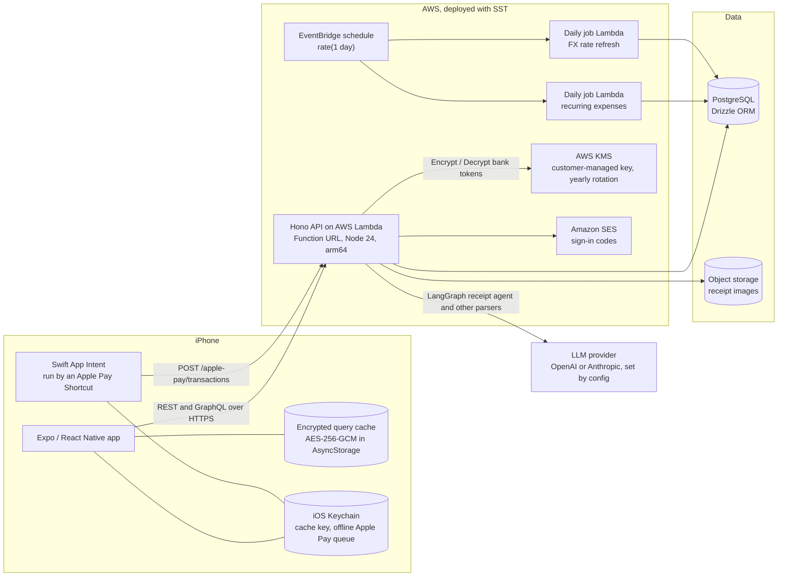

# Architecture

This page shows how the parts of the app fit together. The code is private. The excerpts in [`samples/`](../samples) show the key patterns.

## System diagram

## Request path inside the API

The API follows a ports and adapters layout.

| Layer | What lives there |
| :--- | :--- |
| `entrypoints/` | Hono HTTP routes, middleware, the GraphQL endpoint and the scheduled job handlers |
| `core/` | Domain services such as receipts, budgets, matching, search and voice entry |
| `ports/` | TypeScript interfaces the core depends on, one per repository or external service |
| `adapters/` | Drizzle repositories, LLM adapters, object storage, FX rates and places lookup |
| `container.ts` | Builds every adapter and passes it into the services |

The same Hono app runs locally under Node and on Lambda through `hono/aws-lambda`.

## GraphQL endpoint

The home screen needs receipts, budgets, category totals, bank status, duplicate warnings and FX rates. A single read-only GraphQL endpoint returns them in one request.

- It only accepts POST.
- In production it only runs pre-registered documents. Raw query text and introspection are turned off.
- Queries deeper than 5 levels fail validation.
- The request body is capped at 16 KB.
- All writes stay on REST.
- If the GraphQL call returns any error, the app falls back to its normal REST hooks.

## Scheduled jobs

Two jobs run once a day on an EventBridge schedule.

- **Recurring expenses.** Each rule stores its own next run date. The daily job creates anything due, so a missed day is caught up on the next run.
- **FX rates.** Refreshes stored rates from European Central Bank reference data, which only changes once per business day.

## Authentication

- Passwordless email sign-in with one-time codes, sent through Amazon SES.
- The app sends a bearer session token on each request.
- The Apple Pay Shortcut uses a separate long-lived token. The server stores only a SHA-256 hash of it.
